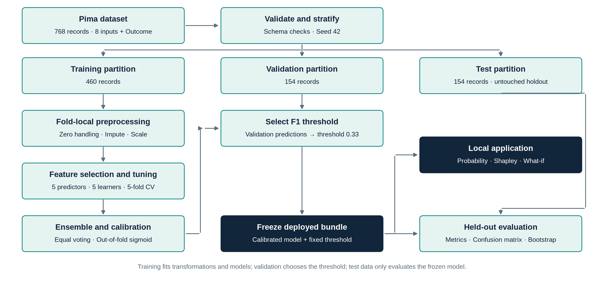
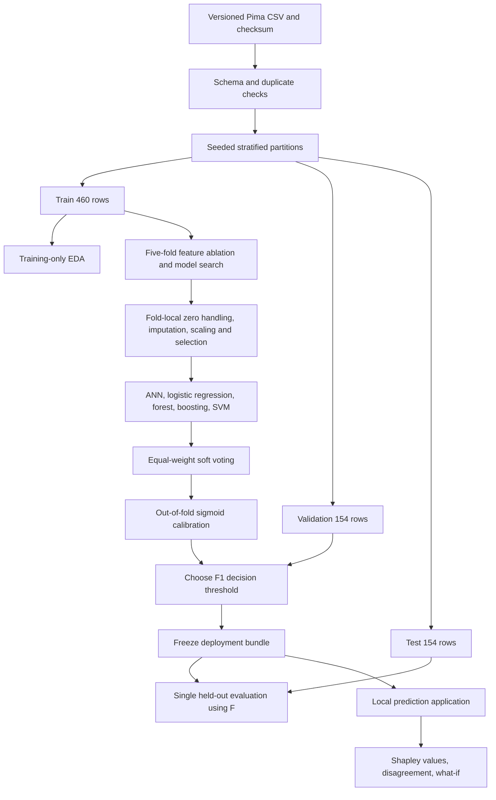

# Architecture and methodology — technical reference

## Data flow

Download the diagram as [SVG](figures/methodology_schematic.svg) or [PDF](figures/methodology_schematic.pdf). The four-page project report includes this schematic on page 2. Regenerate these figures with `MPLCONFIGDIR=/tmp/diabetes-diagram-mpl python scripts/create_methodology_diagram.py`.

Partition sizes above describe the bundled 768-row dataset. A custom dataset may produce other sizes. Saved row indexes in `artifacts/splits.json` identify the exact partitions. Seed 42 is used throughout.

## Data and preprocessing

The target is the existing binary Outcome; it is never reconstructed from Glucose or another predictor. Duplicate feature records fail validation so they cannot silently cross partitions. Numeric coercion, binary-label checks and negative/infinite-value checks precede partitioning. The source contains no categorical predictors, so categorical encoding is unnecessary.

Zero is retained in Pregnancies and replaced with missing in Glucose, BloodPressure, SkinThickness, Insulin and BMI. Median imputation with missingness indicators and standard scaling are fitted inside every training fold. Missingness is not assumed random. The source's heavy insulin/skin-thickness missingness is reported as a limitation. IQR outliers are counted in training data and retained because extreme values are not automatically errors. No manual class resampling occurs; class-weight alternatives are included for logistic regression, forest and SVM. The dummy prior model exposes what happens without informative features.

Three representations are compared on identical five-fold partitions with fixed logistic and ANN learners: all original predictors plus indicators; originals with log-insulin, log-pedigree and Glucose×BMI/100; and five predictors selected by training-fold ANOVA F score. Log transforms address skew and the interaction tests a nonlinear joint association; these are exploratory transformations, not validated clinical biomarkers. Average AUC across the two learners selects a representation using training data only. `reports/feature_ablation.csv` retains every comparison. The selected representation is applied consistently to all final candidate models.

## Training and ANN

RandomizedSearchCV evaluates six candidate configurations per model, each with five stratified folds and ROC-AUC scoring. Full search tables, training scores and fitted parameter choices are saved. The ANN is scikit-learn's genuine multilayer perceptron, using ReLU hidden activations, a sigmoid binary output, Adam, L2 regularization and early stopping on a training-fold internal validation subset. It does not require TensorFlow. Its selected hidden-layer width, learning rate, regularization and convergence information can be inspected from the fitted bundle.

The best training-CV baseline is fixed before evaluating test outcomes. Best CV scores are optimistic because model/feature selection uses these same folds; the untouched holdout is the independent estimate. This is not fully nested CV and no claim of an unbiased tuned CV estimate is made.

## Proposed framework and calibration

Five tuned pipelines produce positive-class probabilities. Their arithmetic mean defines the raw soft-voting ensemble; equal weights are fixed in advance. CalibratedClassifierCV produces out-of-fold training probabilities using five folds and fits a sigmoid calibrator, then fits the underlying voter on all training rows (`ensemble=False`). Every calibrator-fold voter contains its own preprocessing pipelines. Hyperparameters were selected on the same training set; tuning is not repeated within each calibration fold. The final holdout remains separate.

The final ensemble is prespecified as the deployed research framework; it is not selected because of its test score. The validation set selects an F1-maximizing threshold from 0.10 to 0.90 in steps of 0.01, with ties nearest 0.50. The bundle is saved before test evaluation. Validation rows are not later incorporated into model fitting, because doing so would invalidate that fixed threshold. No synthetic samples or test labels influence training.

## Evaluation and statistical comparison

At threshold 0.50, report a common operating point for every model. Separately report each model's own frozen validation threshold. Accuracy=(TP+TN)/N; precision=TP/(TP+FP); recall=TP/(TP+FN); specificity=TN/(TN+FP); F1=2PR/(P+R). ROC-AUC assesses ranking. The recorded PR-AUC is **average precision**, not trapezoidal PR integration. Brier is mean squared probability error; lower is better. Log loss and ten-bin expected calibration error complement the reliability diagram. ECE depends on binning, so its change can disagree with Brier.

The deployed ensemble's 95% intervals use 1,000 stratified bootstrap resamples of the test set and a fixed fitted model/threshold. They characterize test sampling uncertainty conditional on prevalence; they do not include training/tuning uncertainty. A prespecified paired comparison uses the ensemble and training-CV-selected baseline at a common threshold of 0.50. Exact McNemar evaluates paired prediction errors, and the paired stratified bootstrap assesses the ROC-AUC difference. These answer different questions. No multiple-pair significance fishing is performed and no clinical-superiority claim follows.

## Explainability, uncertainty and what-if

Permutation importance evaluates test ROC-AUC drops; it is post-evaluation interpretation and never triggers retraining. Exact Shapley enumeration evaluates all 256 raw-input coalitions against a seeded sample of 24 training background rows. FeatureBuilder, imputation, selection and the calibrated model remain inside the explained callable, so the explanation applies to the full deployed pipeline. For each coalition, omitted features are replaced jointly from a background row and predictions are averaged. The Shapley formula uses |S|!(M−|S|−1)!/M! weights. Check that the baseline plus eight contributions equals the prediction. No separate surrogate classifier is explained.

The global Shapley plot averages absolute contributions for only the first 12 fixed test examples; it is illustrative, not a population-wide global ranking. Interventional substitution ignores dependence between included and omitted features and may create unrealistic combinations. Shapley values and permutation importance describe model behavior, not causes.

Component probability standard deviation exposes disagreement among the five full-training base models. It is not a calibrated prediction interval, statistical coverage guarantee, or an uncertainty decomposition. What-if curves change a measurement while holding other inputs fixed; they are associations in the model, not estimates of intervention benefits. Extrapolation and missing-value notes appear in the UI.

## Application and reproducibility

The local standard-library HTTP server loads the frozen joblib bundle. `predict.py` validates schema, numeric types, integer fields, finite/nonnegative values and dataset age scope. Blank or zero laboratory measurements follow training preprocessing. Values outside training support generate notes. The application rejects cross-origin POSTs and oversized bodies, does not persist input payloads, and binds to localhost.

Each completed run writes package versions, Python version, CSV checksum, partitions, tuning tables, threshold choices, warnings, predictions, metrics, intervals, plots and explanations. Bundled binary artifacts should be loaded only from this trusted local project, and preferably with the recorded package versions. The application is a local academic demonstrator, not a production clinical service.
