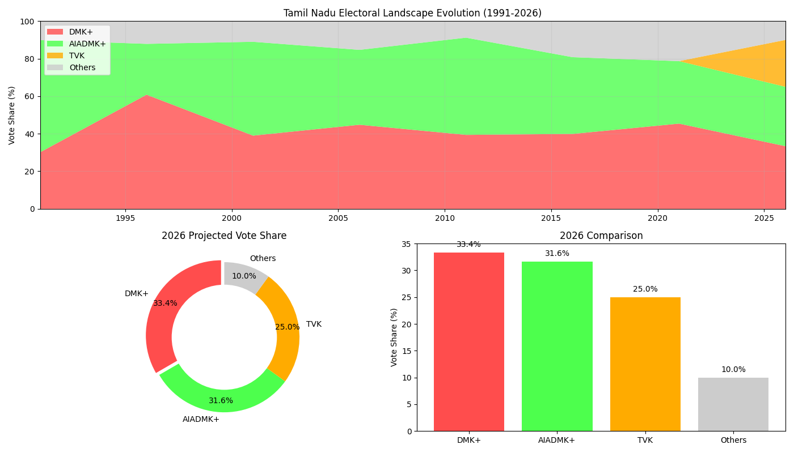

# Tamil Nadu Assembly Election Prediction Model (2026) 🗳️

This project uses Machine Learning (Polynomial Regression) to predict the outcome of the **2026 Tamil Nadu Assembly Election**, specifically analyzing the impact of the new political entrant, **Tamizhaga Vetri Kazhagam (TVK)**.



## 📊 Project Overview

The political landscape of Tamil Nadu has traditionally been bi-polar (DMK vs AIADMK). However, 2026 marks a significant shift with the entry of actor Vijay's party, TVK.

This project:
1.  **Analyzes Historical Trends (1991-2021)**: Uses historical vote share data of DMK and AIADMK alliances.
2.  **Models TVK's Entry**: Integrates recent opinion poll data (estimating ~25% vote share) to simulate the 3-way contest.
3.  **Predicts 2026 Outcome**: Normalizes the vote shares to predict the winner in a hung assembly scenario.

## 🛠️ Methodology

*   **Polynomial Regression**: Used to model the oscillating vote share trends of the major Dravidian parties.
*   **Market Share Normalization**: Since regression cannot account for a new entrant with zero history, TVK's share is injected as a disruption variable, and existing parties' shares are renormalized based on the remaining "market" availability.

## 🚀 How to Run

1.  **Clone the repository:**
    ```bash
    git clone <your-repo-url>
    cd Election-ml
    ```

2.  **Set up a Virtual Environment (Recommended):**
    ```bash
    python3 -m venv venv
    source venv/bin/activate
    ```

3.  **Install Dependencies:**
    ```bash
    pip install pandas numpy scikit-learn matplotlib
    ```

4.  **Run the Prediction Script:**
    ```bash
    python predict_election.py
    ```

5.  **View Results:**
    *   The console will print the predicted vote shares and winner.
    *   A dashboard image `election_dashboard.png` will be generated.

## 📁 Files

*   `predict_election.py`: Main Python script for training and prediction.
*   `tn_election_data.csv`: Historical election data (1991-2021).
*   `election_dashboard.png`: Visualization of the results.

## 📚 Data Sources

*   **Historical Data**: Election Commission of India (ECI), IndiaVotes.
*   **Projections**: Aggregated data from various surveys (India Today, OneIndia, Poll Mitra) for TVK estimates.
